# Memoria Técnica del Frontend — PARA//LELO

**Proyecto Hito 2 · Pruebas, optimización, despliegue y documentación**

| | |
|---|---|
| **Alumno** | Christian Hidalgo Cadena |
| **Ciclo** | Desarrollo de Aplicaciones Web (DAW) |
| **Proyecto** | PARA//LELO — marketplace de objetos de edición limitada |
| **Entrega** | Hito 2 · Noviembre 2026 |

## Enlaces de la entrega

| Recurso | Enlace |
|---|---|
| Repositorio de GitHub | `[PEGAR URL del repositorio]` |
| Tablero Kanban (GitHub Projects) | `[PEGAR URL del tablero]` |
| Prototipo de Figma (Proyecto 1) | [E-commerce Mobile First Prototype](https://www.figma.com/make/oBf5kXsqVjpXzV3ZC1TsQR/E-commerce-Mobile-First-Prototype?p=f&t=pftvOnj1SZCzTbH7-0) |

**Usuario de prueba para el login:** `alex@parallelo.com` · `Parallelo2025`

---

## 1. Introducción

PARA//LELO es la interfaz de una tienda de objetos raros de edición limitada (calzado, audio, objetos y wearables). En el Hito 1 se maquetó a partir del prototipo de Figma. En este Hito 2 se ha convertido en una web interactiva con JavaScript: el catálogo se dibuja a partir de los datos, hay buscador y filtros, cada producto tiene su ficha, los formularios se validan a mano y hay un modal reutilizable para avisos y confirmaciones.

La web está hecha solo con **HTML5, CSS3 y JavaScript sin librerías**. Los datos están en un archivo (`mockData.js`) que imita las tablas `productos` y `usuarios` de la base de datos del Proyecto 1. Así, el día que exista una API, solo hay que cambiar ese archivo por un `fetch()`.

---

## 2. Estructura del proyecto

```
hito2/
├── index.html        → Explorar: catálogo con buscador y filtros
├── detalle.html      → Ficha de producto (detalle.html?id=N)
├── login.html        → Iniciar sesión
├── registro.html     → Crear cuenta
├── crear.html        → Publicar un objeto (modo vendedor)
├── css/
│   ├── styles.css    → Base común: variables, reset, header, botones, formularios, footer
│   ├── index.css     → Solo del catálogo (hero, chips, grid de tarjetas)
│   ├── detalle.css   → Solo de la ficha de producto
│   ├── auth.css      → Login y registro (pantalla partida)
│   ├── crear.css     → Formulario de publicar
│   └── hito2.css     → Componentes nuevos que maneja JS (menú, modal, errores, buscador)
├── js/
│   ├── mockData.js   → Datos: arrays "productos" y "usuarios"
│   ├── ui.js         → Común: menú hamburguesa, modal y carrito
│   ├── dashboard.js  → Pinta el catálogo, buscador y filtros
│   ├── detalle.js    → Rellena la ficha según el id de la URL
│   ├── validacion.js → Reglas de validación y "motor" de formularios
│   └── formularios.js→ Conecta cada formulario con sus reglas
├── img/              → 9 imágenes de producto (JPG)
└── capturas/         → Capturas de las pruebas
```

### 2.1 HTML

Hay cinco páginas, cada una con una tarea concreta. Todas comparten la misma cabecera (logo, menú y carrito) y usan etiquetas semánticas: `header`, `nav`, `main`, `section`, `article`, `figure`, `aside`, `footer` y `dl` para las especificaciones del producto. Cada página tiene `lang="es"`, un único `h1` y sus `meta` de codificación y *viewport*.

El HTML deja preparados los huecos que luego rellena JavaScript. Por ejemplo, en `index.html` la tarjeta de producto está escrita una sola vez dentro de un `<template id="tpl-tarjeta">`, y el `div#grid` empieza vacío.

### 2.2 CSS

El CSS se ha dividido en capas para que cada página cargue solo lo que necesita:

1. **`styles.css`**: la base de todo. Contiene las variables (`:root`), el reset y los componentes que salen en todas las páginas.
2. **Una hoja por página** (`index.css`, `detalle.css`, `auth.css`, `crear.css`).
3. **`hito2.css`**: los estilos de los componentes del Hito 2 que dependen de JS (menú desplegable, modal, mensajes de error, barra de seguridad de la contraseña). Se cargan los últimos, así que pueden sobrescribir lo anterior.

Todos los colores, tipografías y espacios salen de variables CSS sacadas del sistema de diseño de Figma:

| Variable | Valor | Uso |
|---|---|---|
| `--c-ink` | `#1a1a16` | Texto, bordes y fondos oscuros |
| `--c-paper` | `#f4f1ea` | Fondo general |
| `--c-orange` | `#ff6b35` | Acento: carrito, stock bajo, página activa |
| `--c-lime` | `#dcff3f` | Acento: flecha del botón, stock, foco del buscador |
| `--c-violet` | `#6c3bff` | Contorno de foco (`:focus-visible`) |
| `--f-display` | Syne | Titulares en mayúsculas |
| `--f-body` | Space Grotesk | Texto normal |
| `--s-1` … `--s-6` | 0,25rem → 4rem | Escala de espacios |

### 2.3 JavaScript

Los scripts van al final del `body` y en este orden, porque cada uno usa cosas del anterior:

| Página | Scripts que carga |
|---|---|
| `index.html` | `mockData.js` → `ui.js` → `dashboard.js` |
| `detalle.html` | `mockData.js` → `ui.js` → `detalle.js` |
| `login.html`, `registro.html`, `crear.html` | `mockData.js` → `ui.js` → `validacion.js` → `formularios.js` |

- `mockData.js` va siempre primero porque los demás leen `productos` y `usuarios`.
- `ui.js` va siempre segundo porque define `abrirModal()` y el carrito, que usan los demás.
- `validacion.js` solo tiene funciones; quien las usa es `formularios.js`.

Del Hito 1 al Hito 2 se quitaron todos los `onclick` y `oninput` del HTML y se pasaron a `addEventListener` en los archivos JS. Así el HTML queda solo con estructura.

---

## 3. Maquetación: Grid, Flexbox y responsive

### 3.1 Mobile First

Los estilos base son para móvil. Las pantallas grandes se añaden con `@media (min-width: …)`. Los breakpoints están en `em` para que respeten el tamaño de letra que tenga puesto el usuario en el navegador. Los títulos grandes no usan breakpoints: crecen solos con `clamp()`, por ejemplo `font-size: clamp(2.6rem, 14vw, 9rem)`.

### 3.2 Cuándo Grid y cuándo Flexbox

La regla que se ha seguido: **Grid cuando hay que repartir en filas y columnas** y **Flexbox cuando los elementos van en una sola línea** (alinear, separar o poner en columna).

| Componente | Sistema | Por qué |
|---|---|---|
| Catálogo de productos (`.grid`) | **Grid** | 1 → 2 → 4 columnas iguales con `repeat()` |
| Login y registro (`.auth`) | **Grid** | Pantalla partida 57% / 43% en escritorio |
| Publicar objeto (`.publish`) | **Grid** | Zona de imágenes y formulario en `5fr 7fr` |
| Ficha de producto (`.detail`) | **Grid** | Imagen y datos a partes iguales `1fr 1fr` |
| Campos en fila (`.field-row`) | **Grid** | Teléfono + fecha, precio + stock en 2 columnas |
| Especificaciones (`.specs`), pestañas (`.tabs`), barra de fuerza | **Grid** | Celdas de igual ancho |
| Centrar iconos y el modal (`place-items: center`) | **Grid** | Es la forma más corta de centrar en los dos ejes |
| Cabecera (`.site-header .container`) | **Flexbox** | Logo a la izquierda y acciones a la derecha con `space-between`; `wrap` para que el menú baje en móvil |
| Menú principal (`.main-nav`) | **Flexbox** | En columna en móvil y en fila en escritorio |
| Chips de filtros (`.filters`) | **Flexbox** | Una sola fila con scroll horizontal en móvil |
| Datos de la tarjeta, fila de precio, cabecera del catálogo | **Flexbox** | Nombre a un lado y precio al otro |
| Campos de formulario (`.field`) | **Flexbox** | Etiqueta, input y error en columna |
| Botón principal (`.btn`) | **Flexbox** | Texto a la izquierda y flecha a la derecha |
| `body` | **Flexbox** | En columna con `main { flex: 1 }` para que el footer quede abajo aunque haya poco contenido |

### 3.3 Puntos de ruptura

| Breakpoint | Equivale a | Qué cambia |
|---|---|---|
| Base (sin media query) | < 640 px | Una sola columna. Menú hamburguesa. Filtros con scroll horizontal. Login con la imagen arriba |
| `min-width: 40em` | ≥ 640 px | El catálogo pasa a **2 columnas** |
| `min-width: 48em` | ≥ 768 px | El menú hamburguesa desaparece y la navegación se ve en fila en la cabecera. Más margen lateral (`--s-5`). Los campos dobles van en 2 columnas |
| `min-width: 56em` | ≥ 896 px | La ficha de producto se divide en imagen + datos. El formulario de publicar pasa a 2 columnas (`5fr 7fr`) |
| `min-width: 64em` | ≥ 1024 px | El catálogo pasa a **4 columnas**. Login y registro en pantalla partida con la esfera a la izquierda |

Además hay una regla `prefers-reduced-motion: reduce` que quita las animaciones (modal, menú y scroll suave) a quien lo tenga activado en su sistema.

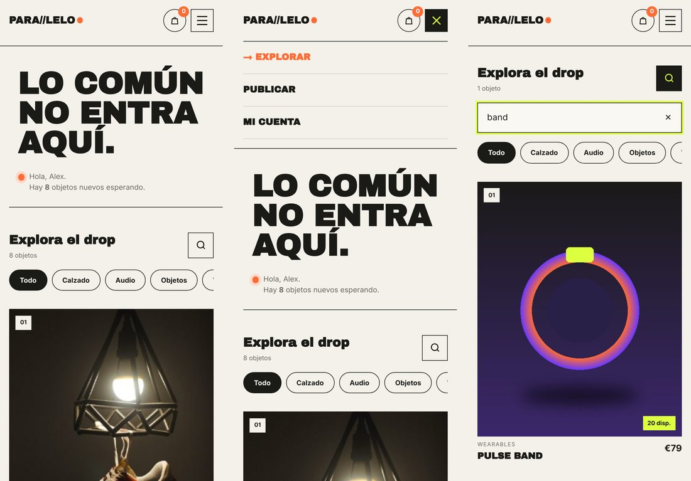
*Figura 1. Móvil (390 px): menú plegado, menú abierto (las tres rayas se convierten en una X) y buscador con resultados.*

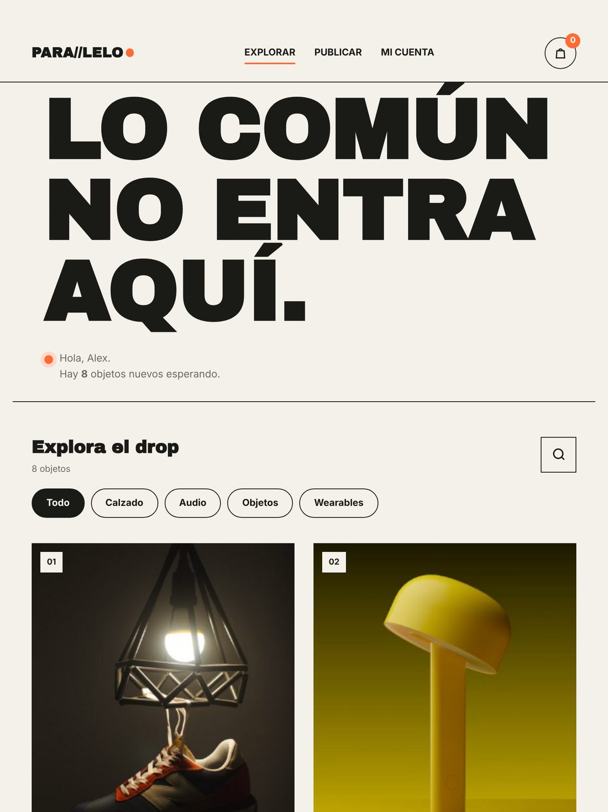
*Figura 2. Tablet (768 px): ya se ve el menú en fila y el catálogo en 2 columnas.*

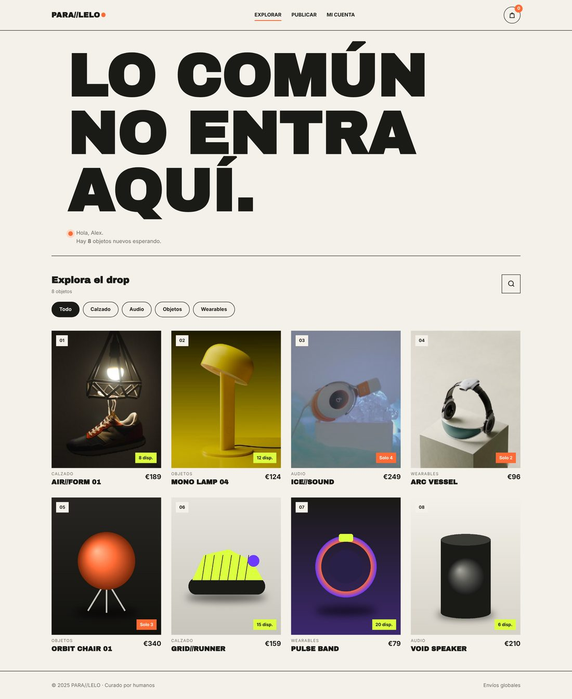
*Figura 3. Escritorio: catálogo en 4 columnas.*

---

## 4. Lógica JavaScript

### 4.1 Renderizado dinámico del catálogo (`dashboard.js`)

Las tarjetas ya no están escritas a mano en el HTML. Se generan a partir del array `productos`:

1. **Plantilla.** `crearTarjeta()` hace una copia del `<template>` con `cloneNode(true)` y rellena la imagen, el `alt`, el número, la categoría, el nombre, el precio y el enlace `detalle.html?id=N`. El texto se mete con `textContent` y no con `innerHTML`, para que nunca se interprete como código.
2. **Stock.** Si quedan 4 unidades o menos, la etiqueta pone "Solo N" y se le añade la clase `.low`, que la pinta naranja.
3. **Filtrado.** `pintarCatalogo()` filtra el array con dos condiciones a la vez: la categoría del chip activo **y** el texto del buscador (busca en nombre, descripción y categoría).
4. **Sin tildes.** `normalizar()` pasa todo a minúsculas y quita las tildes con `normalize('NFD')`. Así, escribir "lampara" encuentra "LÁMPARA" y "ceramica" encuentra "cerámica".
5. **Pintado eficiente.** Las tarjetas se meten en un `DocumentFragment` y se colocan todas juntas con `grid.replaceChildren()`. El navegador recalcula la página una sola vez, no una por tarjeta.
6. **Estados.** El contador ("8 objetos", "1 objeto") se actualiza con `aria-live="polite"`, así el lector de pantalla lo anuncia. Si no hay resultados, aparece el aviso «No hay nada que coincida con …».

La búsqueda es **en tiempo real**: va con el evento `input`, así que filtra con cada tecla. La lupa abre y cierra el panel (`aria-expanded`) y la ✕ borra la búsqueda.

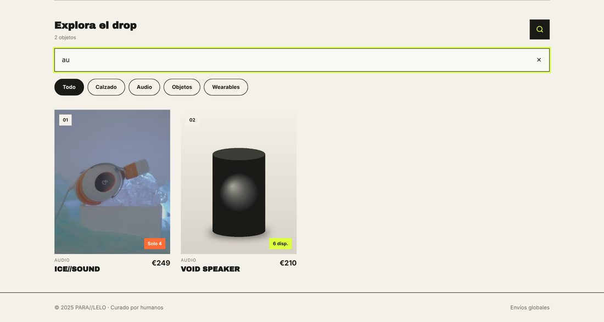
*Figura 4. Búsqueda "au" en tiempo real: busca a la vez en el nombre, la descripción y la categoría.*

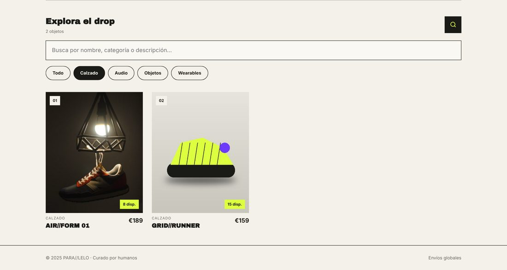
*Figura 5. Filtro por la categoría Calzado.*

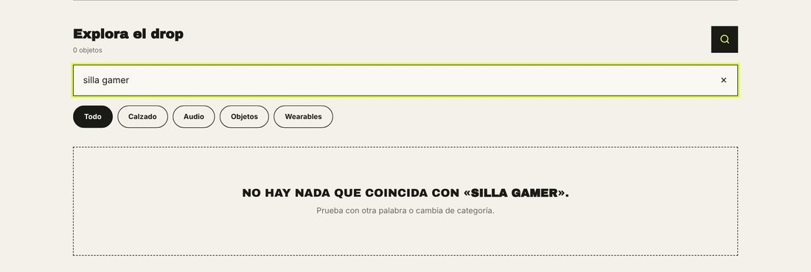
*Figura 6. Mensaje cuando no hay resultados.*

### 4.2 Ficha de producto (`detalle.js`)

Lee el id de la URL con `URLSearchParams` (`detalle.html?id=5`), busca el producto con `productos.find()` y rellena la página: título de la pestaña, imagen, nombre, precio, stock y descripción.

- Si la URL no trae id, se muestra la lámpara (id 2), que era la ficha del Hito 1.
- Si el id no existe (por ejemplo `?id=99`), sale un modal de «Objeto no encontrado» y al cerrarlo vuelve al catálogo.
- El botón de comprar pide confirmación y, si se acepta, suma 1 al carrito.
- El corazón de favoritos cambia `aria-pressed` y el CSS lo pinta naranja.

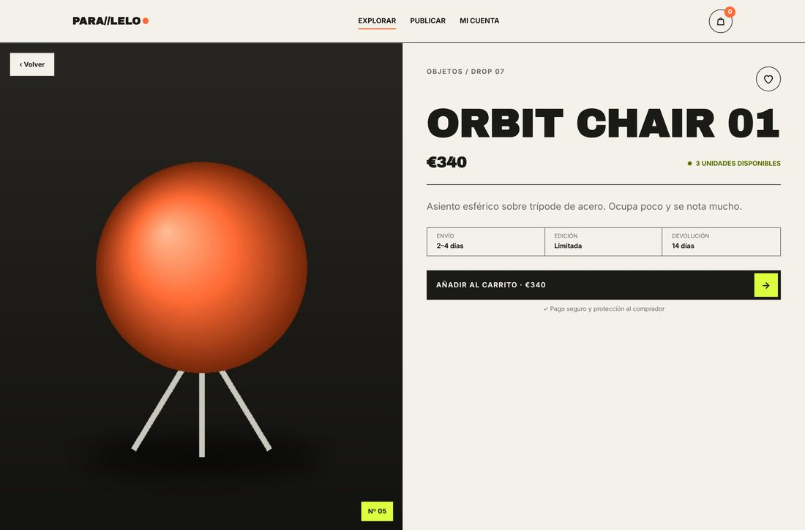
*Figura 7. Ficha generada para `detalle.html?id=5`.*

### 4.3 Componentes comunes (`ui.js`)

**Modal reutilizable.** `abrirModal({ titulo, texto, tipo, textoAceptar, textoCancelar })` crea el modal en el DOM y devuelve una **Promise** que se resuelve con `true` (Aceptar) o `false` (Cancelar). Así, en el resto del código se puede escribir de forma sencilla:

```js
const ok = await abrirModal({ titulo: '¿Añadir al carrito?', tipo: 'confirmar' });
if (ok) actualizarCarrito(leerCarrito() + 1);
```

Para que sea accesible:
- Lleva `role="dialog"` (o `alertdialog` si es de confirmar) y `aria-modal="true"`.
- El foco va al botón principal al abrirse y **no puede salir del modal** con Tab.
- Se cierra con Escape o haciendo clic fuera, y el foco vuelve al elemento que lo abrió.
- Mientras está abierto, la página de detrás no hace scroll (`body.sin-scroll`).

**Menú hamburguesa.** Cambia `aria-expanded` y la clase `.abierto`. El CSS anima `max-height` y convierte las tres rayas en una X. Se cierra con Escape, al pulsar un enlace o al pasar a tamaño escritorio (`matchMedia`).

**Carrito.** El número se guarda en `sessionStorage`, así que se mantiene al cambiar de página. Va dentro de `try/catch` por si el navegador no deja guardar.

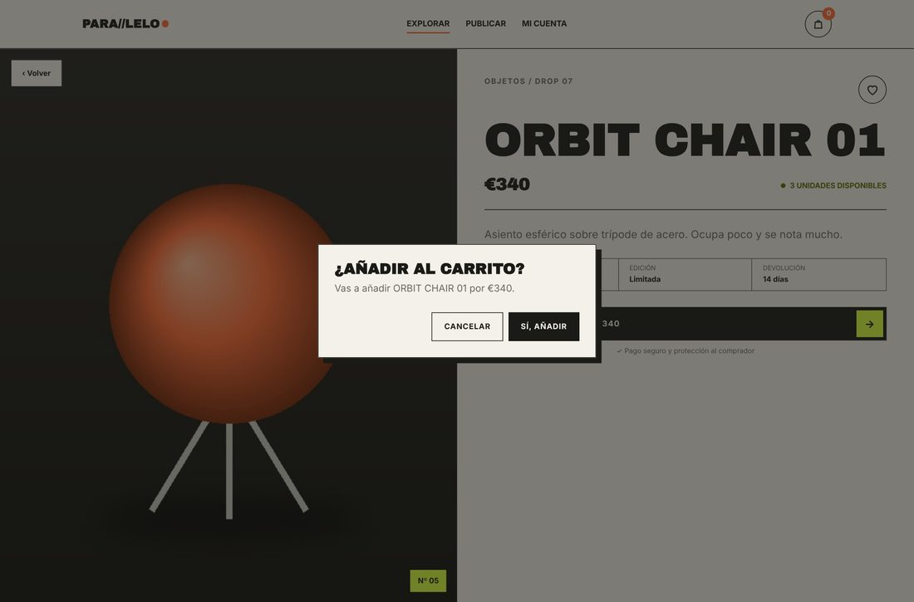
*Figura 8. Modal de confirmación antes de añadir al carrito.*

### 4.4 Validación de formularios (`validacion.js` + `formularios.js`)

Los formularios llevan `novalidate` para quitar los avisos del navegador y usar mensajes propios, en castellano y con la misma estética que la web.

**Cómo funciona el motor.** `configurarFormulario(form, reglas, alEnviar)` recibe un objeto `{ idDelCampo: función }`. Cada función devuelve el texto del error o `""` si el campo está bien.

1. **Al salir del campo (`blur`)** se valida por primera vez y el campo queda marcado como "tocado".
2. **Después, con cada tecla (`input`)** se vuelve a validar, así el usuario ve cómo desaparece el error mientras lo corrige. Antes de tocar un campo no se valida al escribir, para no enseñar un error rojo nada más empezar.
3. **Al enviar** se validan todos los campos. Si alguno falla, se cancela el envío y el foco va al primer campo con error. Si todo está bien, se ejecuta `alEnviar()`.

Cada error se escribe en un `<p class="error-msg">` creado debajo del campo. Ese párrafo se enlaza al input con `aria-describedby`, y al input se le pone `aria-invalid`. Las clases `.invalido` y `.valido` pintan el borde en rojo o verde.

| Formulario | Campo | Reglas |
|---|---|---|
| Login | Email | Obligatorio, que tenga @, formato válido |
| | Contraseña | Obligatoria, mínimo 8 caracteres. Después se comprueba contra `usuarios` y, si no coincide, aparece un error general |
| Registro | Nombre | Mínimo 3 letras, solo letras y espacios, al menos un apellido |
| | Teléfono | Opcional. Si se rellena, tiene que ser un número español (`+34` opcional, empieza por 6, 7, 8 o 9) |
| | Fecha de nacimiento | No puede ser futura ni anterior a 1900. **Hay que tener 18 años o más** (se calcula la edad exacta, mirando si ya ha cumplido este año) |
| | Contraseña | 8+ caracteres, una mayúscula, un número y sin espacios. Barra de seguridad con 4 niveles |
| | Repetir contraseña | Tiene que coincidir; se vuelve a comprobar si cambia la primera |
| | Términos | El checkbox tiene que estar marcado |
| Publicar | Imágenes | Entre 1 y 5, solo JPG o PNG, máximo 10 MB cada una |
| | Nombre | 3 a 40 caracteres y **que no exista ya** en `productos` |
| | Categoría | Hay que elegir una |
| | Descripción | Mínimo 20 caracteres (con contador 0/240) |
| | Precio | Mayor que 0, como mucho 2 decimales, máximo 10.000 € |
| | Stock | Número entero entre 1 y 500 |
| | Fecha de lanzamiento | Desde hoy hasta un año como máximo |

Las fechas se leen con `leerFecha()`, que crea la fecha en hora local. Así no hay fallos de un día por la zona horaria.

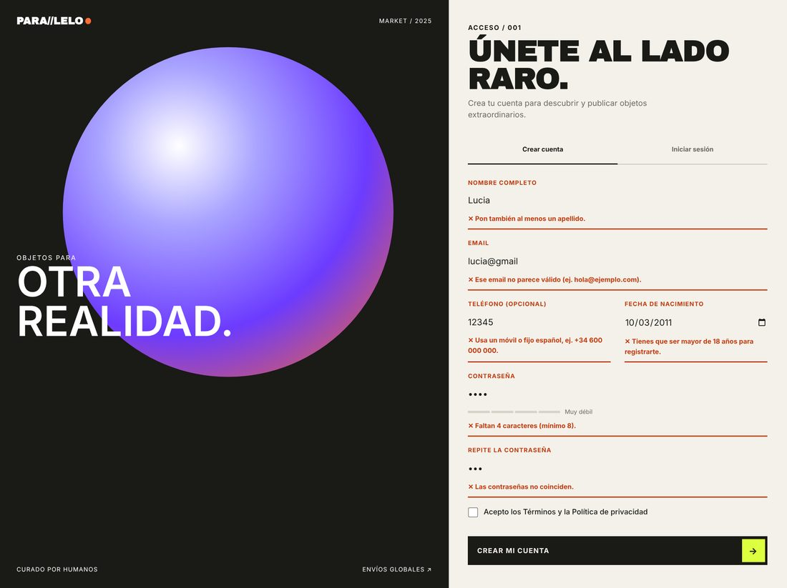
*Figura 9. Registro con errores: cada campo explica qué le falta.*

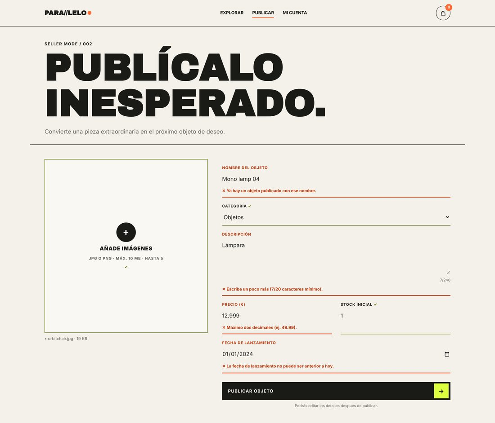
*Figura 10. Publicar objeto: errores que se actualizan mientras se escribe.*

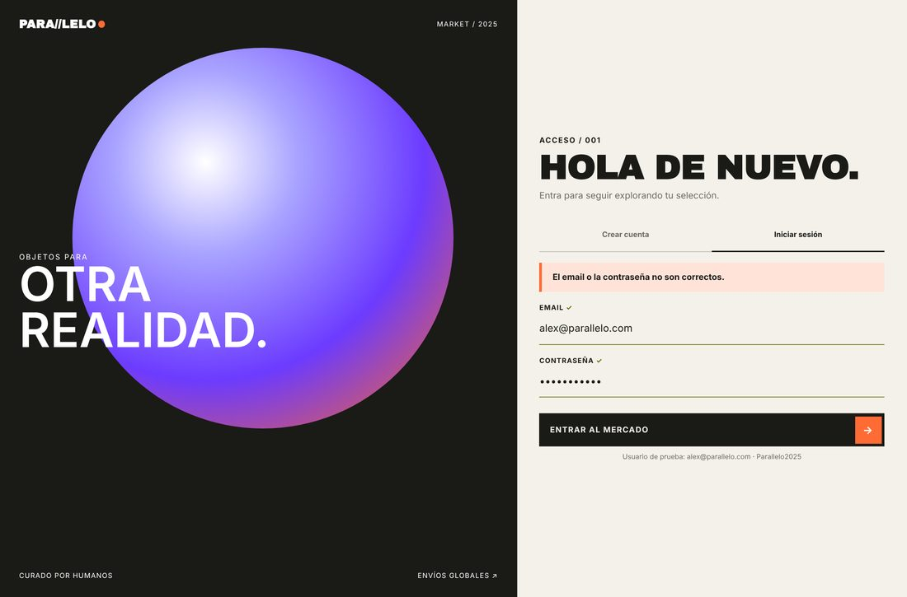
*Figura 11. Login con credenciales incorrectas: error general del formulario.*

---

## 5. Pruebas y optimización

### 5.1 Consola del navegador

Se abrieron todas las páginas en Chrome, en móvil (390 px) y en escritorio (1440 px), probando también los casos raros de la ficha (id válido, sin id e id inexistente). **Resultado: 0 errores y 0 avisos en la consola en las 14 pruebas.**

| Página | Móvil 390 px | Escritorio 1440 px |
|---|---|---|
| `index.html` | ✓ 0 errores | ✓ 0 errores |
| `detalle.html?id=1` / `?id=5` | ✓ 0 errores | ✓ 0 errores |
| `detalle.html?id=99` (no existe) | ✓ 0 errores (sale el modal) | ✓ 0 errores |
| `login.html` | ✓ 0 errores | ✓ 0 errores |
| `registro.html` | ✓ 0 errores | ✓ 0 errores |
| `crear.html` | ✓ 0 errores | ✓ 0 errores |

### 5.2 Fallos encontrados y corregidos en esta fase

| Problema | Dónde | Solución |
|---|---|---|
| En móvil la página se podía mover hacia los lados (scroll horizontal de 16 px) | `.hero` en `index.css` | El hero tenía `width: 100%` y además `margin-inline`, así que se salía de la pantalla. Se añadió `width: auto` |
| W3C: `src=""` vacío en una imagen es un error | Plantilla de tarjeta (`index.html`) e imagen de `detalle.html` | Se puso una ruta de imagen real por defecto; JS la cambia después |
| W3C: el atributo `placeholder` no se permite en `input type="date"` | Fecha de nacimiento (`registro.html`) | Se quitó el atributo |
| `h1` vacío en la ficha hasta que carga JS | `detalle.html` | Ahora pone «Cargando…» por defecto |
| El logo de la columna decorativa se podía enfocar con Tab aunque estaba dentro de un `aria-hidden` | `login.html`, `registro.html` | Se le añadió `tabindex="-1"` |
| Las fechas mínimas y máximas del calendario usaban `toISOString()`, que trabaja en UTC: entre las 00:00 y la 01:00 (hora de España) marcaba el día anterior | `formularios.js` | Nueva función `fechaISO()` que usa la fecha local |

### 5.3 Validación W3C

Se pasaron los 5 HTML por el validador [validator.w3.org](https://validator.w3.org/) y los 6 CSS por [jigsaw.w3.org/css-validator](https://jigsaw.w3.org/css-validator/).

> **PENDIENTE:** pegar aquí las capturas del validador con el mensaje *"Document checking completed. No errors or warnings to show."* de cada página.

Nota: en `hito2.css` se usa `::-webkit-search-cancel-button` para ocultar la ✕ que Chrome pone en los buscadores (la web ya tiene su propio botón para borrar). El validador CSS lo marca solo como **aviso**, porque es una extensión de navegador; no es un error.

### 5.4 Accesibilidad y rendimiento

- **Accesibilidad:** todos los inputs tienen su `label`, todas las imágenes tienen `alt` y no hay ids repetidos (comprobado con un script en las 5 páginas). Además: contorno de foco visible en violeta, texto oculto para lectores de pantalla (`.visually-hidden`), `aria-current` en la página activa, `aria-pressed` en filtros y favoritos, `aria-live` en el contador y en los errores.
- **Rendimiento:** imágenes del catálogo con `loading="lazy"`, `preconnect` a Google Fonts con `display=swap`, catálogo pintado de una vez con `DocumentFragment`, scripts al final del `body` y sin librerías externas.

---

## 6. Preparación para el despliegue

La web es **estática**: solo HTML, CSS, JS e imágenes, sin servidor ni base de datos. Por eso puede publicarse tal cual en GitHub Pages, Netlify o Vercel, sin compilar nada. Se ha dejado lista para eso:

- **Rutas relativas** en todo el proyecto (`css/…`, `js/…`, `img/…`), así que funciona igual abierta en local que dentro de la subcarpeta que usa GitHub Pages (`https://<usuario>.github.io/<repositorio>/`).
- **`index.html` en la raíz** del proyecto, que es la página que sirven estos servicios por defecto.
- **Sin dependencias**: no hay `node_modules` ni paso de *build*. Lo único externo son las fuentes de Google Fonts.

Para publicarla en GitHub Pages bastaría con ir a **Settings → Pages → Deploy from a branch**, elegir la rama `main` y la carpeta `/ (root)`.

En esta entrega las pruebas se han hecho en local, abriendo las páginas en Chrome (ver apartado 5).

---

## 7. Fidelidad del desarrollo: Figma vs. web

**Prototipo de Figma (Proyecto 1):** [E-commerce Mobile First Prototype](https://www.figma.com/make/oBf5kXsqVjpXzV3ZC1TsQR/E-commerce-Mobile-First-Prototype?p=f&t=pftvOnj1SZCzTbH7-0)

El prototipo está hecho en **Figma Make**, así que no es una serie de *frames* estáticos sino una maqueta navegable. La captura del registro es la vista previa oficial del propio archivo de Figma. El resto de capturas de la izquierda se han sacado navegando el prototipo con su mismo código y estilos. Dos diferencias de esas capturas: las fotos de producto se han cambiado por las del proyecto (en el prototipo se cargan desde Unsplash), y las tipografías Syne y Space Grotesk aparecen sustituidas por otras parecidas.

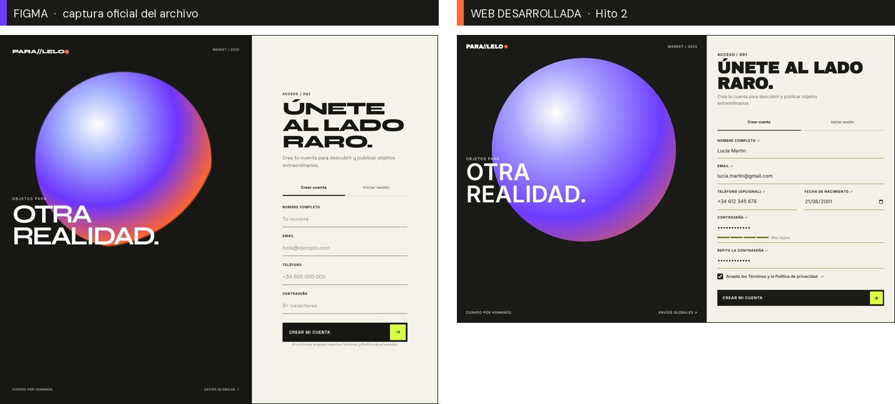
*Figura 12. Registro en escritorio. A la izquierda, la captura oficial de Figma; a la derecha, la web con el formulario rellenado y validado.*

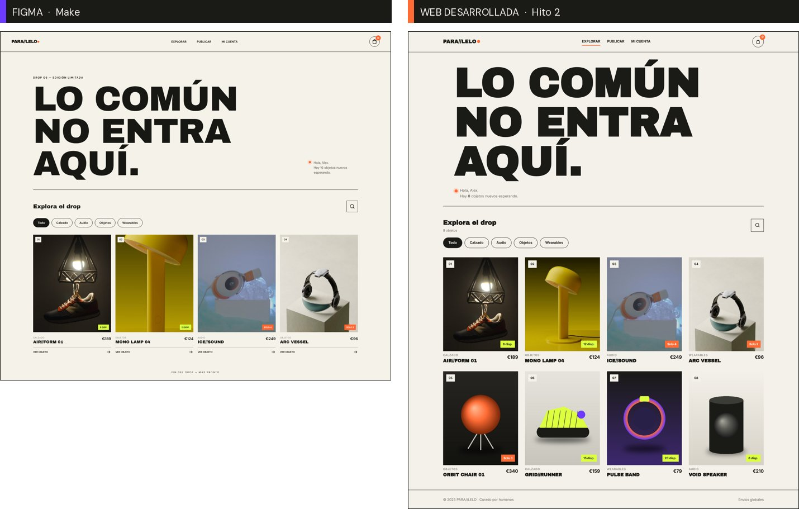
*Figura 13. Catálogo en escritorio.*

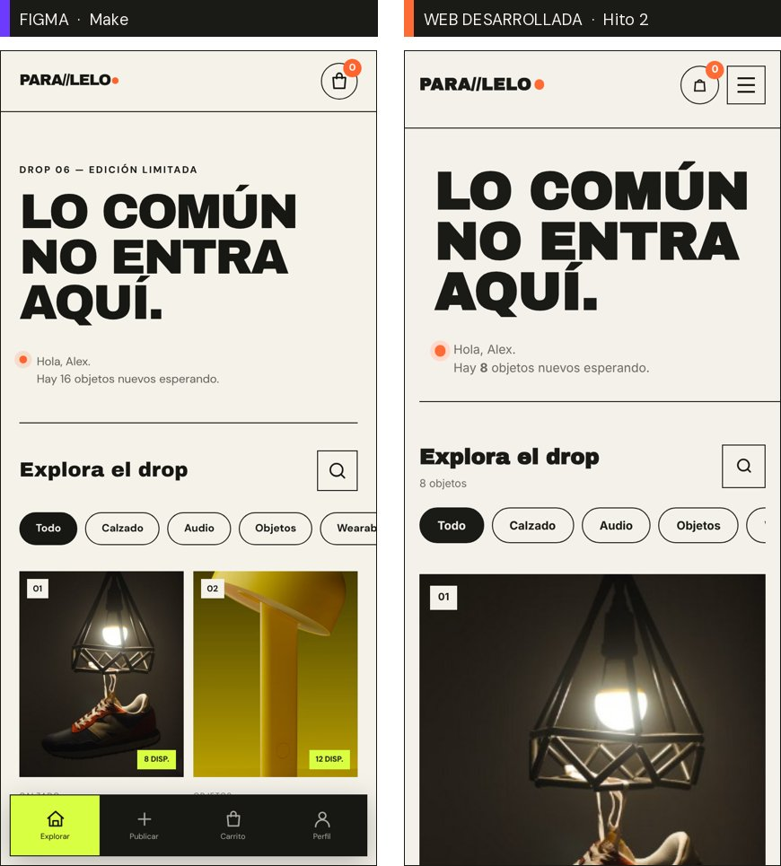
*Figura 14. Catálogo en móvil.*

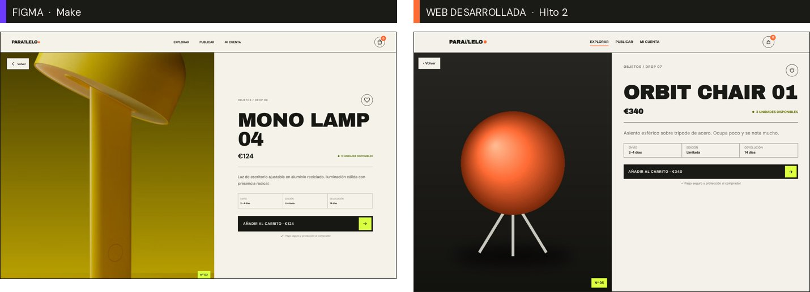
*Figura 15. Ficha de producto.*

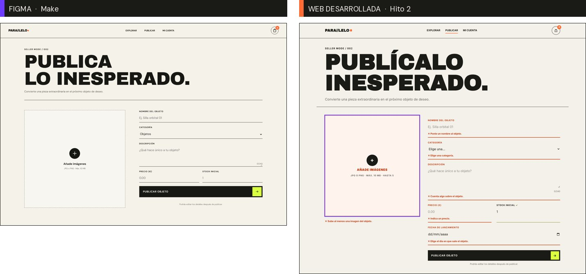
*Figura 16. Publicar objeto. En la web se ve el formulario después de intentar enviarlo vacío.*

### 7.1 Qué se ha respetado

| Elemento | Figma | Web |
|---|---|---|
| Paleta | Tinta `#171713`, papel `#f4f2e9`, naranja `#ff642f`, lima `#d9ff43`, violeta `#6c36ff` | Los mismos colores como variables CSS (con mínimas variaciones de tono) |
| Tipografía | Syne para títulos, Space Grotesk para texto | Igual |
| Titulares | Enormes, en mayúsculas, con `clamp()` | Igual |
| Tarjeta de producto | Foto 4:5, número arriba a la izquierda, etiqueta de stock abajo a la derecha (naranja si quedan menos de 5) | Igual |
| Botón principal | Negro con la flecha en un cuadrado lima | Igual |
| Formularios | Solo línea inferior y etiqueta pequeña en mayúsculas | Igual |
| Login y registro | Pantalla partida: esfera en degradado a la izquierda y formulario a la derecha | Igual |
| Ficha de producto | Imagen y datos en dos columnas, tabla de 3 especificaciones y botón con el precio | Igual |
| Textos | «Lo común no entra aquí», «Únete al lado raro», «Seller mode / 002»… | Igual |

### 7.2 Diferencias y por qué

| Diferencia | Figma | Web | Motivo |
|---|---|---|---|
| Navegación en móvil | Barra inferior fija con 4 iconos | Menú hamburguesa desplegable | Con varias páginas HTML separadas, el menú hamburguesa permite usar la misma cabecera en todas y deja libre la parte baja de la pantalla para los botones de los formularios |
| Columnas del catálogo en móvil | 2 columnas desde el principio | 1 columna; 2 desde 640 px | Con 2 columnas en 390 px los nombres y precios se quedaban en 8–12 px, demasiado pequeños |
| Breakpoints | Uno solo, 768 px | Cuatro: 640, 768, 896 y 1024 px | Así se ajusta mejor cada pantalla en tablet (ver apartado 3.3) |
| Login y registro | Una pantalla con pestañas | Dos páginas (`login.html` y `registro.html`) | Cada formulario tiene su URL y su propio JS de validación |
| Campos del registro | Nombre, email, teléfono y contraseña | Además: fecha de nacimiento (mayor de 18), repetir contraseña, barra de seguridad y casilla de términos | Más validaciones, que eran el objetivo del Hito 2 |
| Publicar objeto | Sin fecha | Añade fecha de lanzamiento y la lista de imágenes elegidas | Para validar fechas, igual que en el registro |
| Búsqueda | Solo por nombre, distingue tildes | Nombre, descripción y categoría, sin tildes | Mejora del Hito 2 |
| Catálogo | 4 productos | 8 productos desde `mockData.js` | Datos de prueba más completos |
| Carrito y perfil | Pantallas de carrito, pago y perfil | Contador del carrito con un modal | Quedan fuera del alcance de este hito; están en las mejoras futuras |
| Tarjeta de producto | Barra «Ver objeto →» debajo | Toda la tarjeta es un enlace | Un solo enlace por tarjeta, más limpio para teclado y lector de pantalla |
| Avisos | *Toast* arriba y modal solo al pagar | Modal reutilizable para todo (confirmar, avisar, errores) | Un único componente accesible |

---

## 8. Repositorio y organización del trabajo

### 8.1 Historial de commits

Los commits siguen el formato `tipo: descripción` (`feat`, `fix`, `style`, `refactor`, `docs`) para que se vea qué se hizo en cada uno.

| Sesión | Trabajo |
|---|---|
| 1 | Estructura de carpetas, `mockData.js` y renderizado del catálogo con `<template>` |
| 2 | Buscador en tiempo real, filtros combinados y ficha dinámica con `?id=` |
| 3 | Menú hamburguesa, modal reutilizable y carrito con `sessionStorage` |
| 4 | Motor de validación y reglas de login, registro y publicar |
| 5 | Pruebas en consola y W3C, correcciones, preparación para el despliegue y memoria |

> **PENDIENTE:** pegar aquí el resultado de `git log --oneline` o una captura de la pestaña *Commits* del repositorio.

### 8.2 Tablero Kanban

El trabajo se organizó en un tablero de **GitHub Projects** con las columnas *Por hacer → En progreso → Completado*. Cada tarea del hito era una tarjeta. Al terminar la entrega, todas están en **Completado**.

> **PENDIENTE:** captura del tablero con todas las tarjetas en "Completado".

---

## 9. Conclusiones

El paso más importante de este hito ha sido **separar los datos de la vista**: el catálogo y la ficha ya no están escritos a mano, sino que se generan desde `mockData.js`. Por eso, conectar la web a la base de datos del Proyecto 1 solo exigirá cambiar de dónde salen los datos.

El modal basado en Promises y el motor de validación con reglas en un objeto han evitado repetir código: los tres formularios usan el mismo motor y solo cambian sus reglas. La fase de pruebas también fue útil: encontró fallos que no se veían a simple vista, como el scroll horizontal de 16 px en móvil o el desfase de fechas por la zona horaria.

**Mejoras para el siguiente hito:** sustituir `mockData.js` por llamadas `fetch()` a una API real, guardar la sesión del usuario, publicar la web en GitHub Pages y terminar las pantallas del prototipo que faltan: el carrito con productos concretos, el pago y el perfil.
